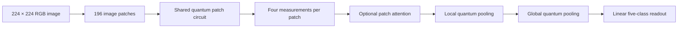

# Patch QCNN for Crop Disease Classification

A standalone research implementation of a hierarchical **quantum convolutional neural network (QCNN)** for crop-image classification. The repository contains the quantum model, classical comparison models, frozen data splits, completed experiment results, and the protocols used to interpret them.

The study asks whether a quantum patch-processing hierarchy can learn useful disease features from image pixels, and how its performance changes when patch magnitude, circuit depth, and attention are varied. The quantum path uses image pixels directly, without a pretrained image encoder or PCA.

**Current finding:** preserving magnitude improves QCNN performance, but the tested quantum models remain below the stronger quadratic classical comparator. This repository documents a controlled architectural study; it does not establish quantum advantage.

## How the model works

The implementation resizes an RGB image to **224 × 224**, normalizes it using that image's own statistics, and divides it into **196 non-overlapping 16 × 16 patches**.



For the main amplitude encoding, each patch's 768 pixel values are reordered, padded to 1,024 entries, and normalized for a **10-qubit register**. A shared trainable circuit produces four measured features per patch. Local pooling combines neighboring patches; global pooling produces eight features for the final classifier. Measurements connect the hierarchy's stages, so this is not one coherent circuit spanning the whole image.

The implemented encodings are:

| Encoding | Purpose |
| --- | --- |
| `amplitude10` | Main 10-qubit amplitude representation. |
| `amplitude10_mag` | Adds channel means and a patch-norm signal to recover information lost by amplitude normalization. |
| `channel8` | Alternative encoding with an 8-qubit register for each color channel. |

The primary simulator is PennyLane's `default.qubit`, using backpropagation and batched patch evaluation. See [the model](scripts/qcnn_model.py) and [pixel preparation](scripts/patch_encode.py) for the implementation.

## Completed results

Test Macro-F1 below is the mean ± sample standard deviation across seeds **0, 1, and 2** on the frozen five-class task.

| Model | Test Macro-F1 |
| --- | ---: |
| Base QCNN | 0.4481 ± 0.0637 |
| QCNN with magnitude preservation | 0.5442 ± 0.0473 |
| QCNN with two re-upload rounds + magnitude | 0.5464 ± 0.0345 |
| QCNN with patch attention | 0.5068 ± 0.0542 |
| Corrected B-PCNN classical control | 0.2922 ± 0.0078 |
| B-QUAD quadratic classical control | **0.7264 ± 0.0198** |

Magnitude restoration helped substantially; additional depth added little on top of it. Attention did not improve on QCNN-mag. B-PCNN and B-QUAD are retained because the conclusion depends on the strength of the classical comparator.

- **Complete:** clean Phase A, depth/magnitude ablations, attention experiments, and saliency analysis.
- **Not complete:** Phase B corruption evaluation remains a stub; the further attention-expansion trigger was not met.
- **Evidence:** [clean/magnitude report](results/QCNN_REPORT.md), [function-class and depth study](results/function_class.md), and [attention report](results/ATTENTION_REPORT.md). These reports also include accuracy, calibration, and per-class results.

## Quick start: no dataset required

The commands below use Windows PowerShell and Python 3.10, matching the verified source CPU interpreter family.

```powershell
git clone https://github.com/Shafin-paranoid-Ahmed/qcnn.git
Set-Location qcnn
py -3.10 -m venv .venv
& .\.venv\Scripts\python.exe -m pip install -r requirements.txt
& .\.venv\Scripts\python.exe scripts/smoke_test.py
```

If you already have the local checkout, start from its root and skip the clone step. Calling the environment's Python explicitly means activation is optional.

The smoke check creates a synthetic image and checks preprocessing, finite logits, and finite gradients for the base and magnitude-plus-attention models. It needs no crop dataset or quantum hardware and does not write research results. Successful output includes two `PASS` lines.

The dependency versions are recorded in [requirements.txt](requirements.txt). Extraction checks used an existing installed environment; a completely fresh installation and other operating systems were not verified. See [VALIDATION.md](VALIDATION.md) for the exact boundary.

## Dataset and frozen splits

Raw images are **not bundled**. Obtain the original Dacon crop disease dataset under its applicable terms. The included manifests define the five-class `crop3_disease` task: `3_00_0`, `3_b3_1`, `3_b6_1`, `3_b7_1`, and `3_b8_1`.

All selected samples come from the original trusted `test.csv` pool. The files in [splits/](splits/) divide that pool into this experiment's training, validation, and test partitions. The original dataset filename therefore does not mean the entire pool is used as the final evaluation set.

Set `QCNN_DATA_ROOT` to a directory with this layout:

```text
your-dataset-root/
├── test.csv                 # Needed only when rebuilding manifests
└── test/
    └── <image-id>/
        └── <image-id>.jpg
```

```powershell
$env:QCNN_DATA_ROOT = 'D:\datasets\dacon'
& .\.venv\Scripts\python.exe scripts/train_qcnn.py --help
```

The default data location is this repository's `data/` folder. Keep the shipped seed 0/1/2 manifests unchanged when reproducing the saved comparisons. `scripts/build_splits.py` is available for deliberate split construction, not a required quick-start step.

## Running an experiment

After configuring the dataset, a one-epoch dataset smoke can be launched with a distinct artifact tag:

```powershell
$PY = '.\.venv\Scripts\python.exe'
& $PY scripts/train_qcnn.py --split-seed 0 --smoke --tag readme_smoke --batch-size 4 --encoding amplitude10
```

Unlike the synthetic check, this command reads real data and writes outputs. Training writes histories and metrics under `results/` and checkpoints under `checkpoints/`. Reusing an artifact name can overwrite files, so use a disposable checkout for full reproduction and keep the published evidence intact.

The [current runbook](RUN_COMMANDS.md) contains the registered clean comparison command. The [historical runbook](docs/historical/ORIGINAL_RUN_COMMANDS.md) preserves ablation budgets and seeds; its old machine paths must be adapted to the standalone layout. Full scientific runs are separate from the quick checks above.

## Repository guide

| Path | What to find there |
| --- | --- |
| [scripts/qcnn_model.py](scripts/qcnn_model.py) | Shared patch circuit, pooling hierarchy, and attention gate. |
| [scripts/patch_encode.py](scripts/patch_encode.py) | Pixel normalization, patch extraction, and amplitude preparation. |
| [scripts/baselines.py](scripts/baselines.py) | Classical controls used to assess the quantum model. |
| [scripts/train_qcnn.py](scripts/train_qcnn.py) | Single-model training, validation selection, and evaluation. |
| [scripts/run_experiment.py](scripts/run_experiment.py) | Clean comparison orchestration and aggregation. |
| [scripts/attention_experiment.py](scripts/attention_experiment.py) | Attention comparisons and saliency export. |
| [splits/](splits/) | Frozen split manifests. |
| [results/](results/) | Historical metrics, reports, tables, and figures. |
| [checkpoints/](checkpoints/) | Small checkpoints tracked in the original source snapshot. |
| [docs/protocols/](docs/protocols/) | Specifications and proposed extensions, with historical context. |

For a reading order, start with the result reports, then the [main protocol](docs/protocols/full_qcnn.md), and finally the relevant implementation files.

## Reproducibility and provenance

This repository is a clean standalone snapshot of the original thesis experiment. It does not require the thesis repository or the separate QEMCMC project. Frozen artifacts preserve their source bytes; historical metadata may still mention the machines on which the experiments ran.

- [PROVENANCE.md](PROVENANCE.md): source commit, contributor record, and extraction changes.
- [SOURCE_MANIFEST.json](SOURCE_MANIFEST.json): original and extracted file hashes.
- [VALIDATION.md](VALIDATION.md): successful synthetic checks, fresh-clone verification, and checks not performed.
- [EXTRACTION_CHECKLIST.md](EXTRACTION_CHECKLIST.md): completed separation and publication checklist.
- [NOTICE.md](NOTICE.md): attribution and licensing status; extraction did not assign a new redistribution license.
